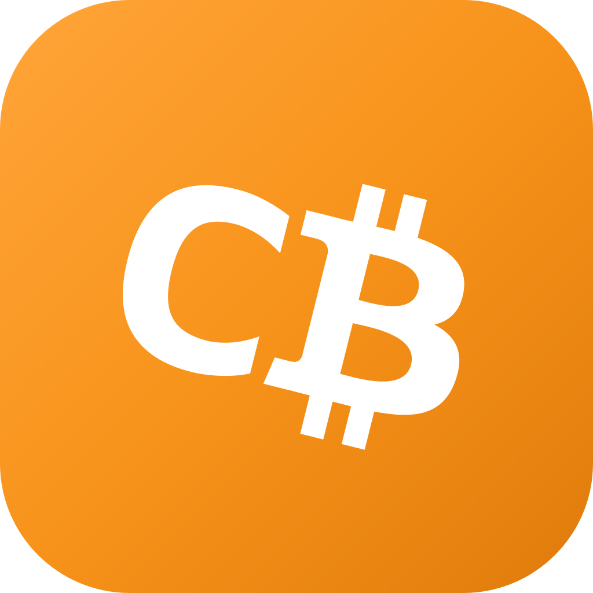
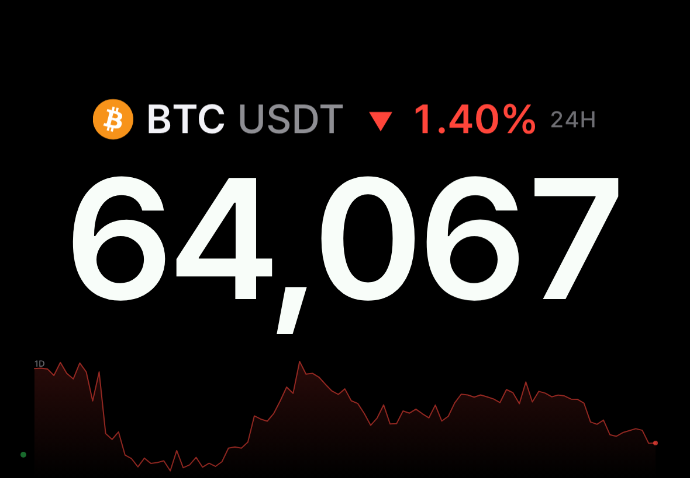
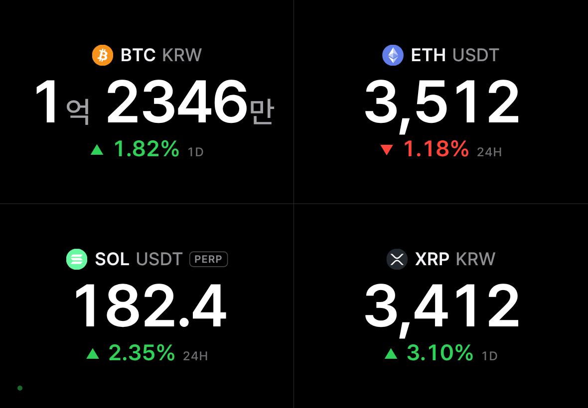

<h1 align="center">Coinboard</h1>

<a href="README.md">English</a> · 한국어

코인 시세 전광판입니다. 거래소 WebSocket으로 받은 실시간 시세를 큰 글자로 띄워 두는 웹앱(PWA)이고, 항상 켜 두는 아이패드를 기준으로 만들었습니다. 아이폰이나 컴퓨터에서도 씁니다.

**바로 열기: https://2jiho.github.io/coinboard/**

- **시장**: 원화는 업비트·빗썸·코인원, USDT는 바이낸스·OKX·바이비트의 현물과 무기한 선물(`PERP` 표시), 달러는 코인베이스·크라켄. 처음에는 바이낸스 BTC를 보여 줍니다.
- **여러 자산**: 하나면 화면 가득, 둘 이상이면 화면을 칸으로 나눈 그리드로 보여 줍니다. 시장을 섞어도 됩니다.
- **차분한 전광판**: 바뀐 자리의 숫자만 부드럽게 바뀌고, 움직임이 클수록 색이 진하며, 모든 칸이 3초 박자에 맞춰 함께 바뀝니다.
- **켜 두기 위한 기능**: 화면 켜짐 유지, 번인 방지 이동, 밝기 조절, 오프라인 실행, 자동 업데이트.
- **한국어·영어**: 설정 창은 기기 언어를 따라 한글 또는 영어로 나옵니다. 원화 가격은 한국어에서 `억`·`만`, 영어에서 `89.96M`처럼 씁니다.
- **개인정보**: 계정도, 자체 서버도, 추적도 없습니다. 설정은 기기에만 저장됩니다.

## 빠른 시작

1. 아이패드·아이폰은 Safari, 그 밖에는 Chrome으로 https://2jiho.github.io/coinboard/ 를 엽니다.
2. 홈 화면에 추가합니다. iOS는 공유 → **홈 화면에 추가**, 안드로이드는 ⋮ → **앱 설치**.
3. 홈 화면 아이콘으로 엽니다. 화면을 한 번 누르면 오른쪽 아래에 설정 버튼이 나타나고, 거기서 자산을 고릅니다.

## 문서

- [사용 설명서](docs/guide.ko.md): 화면 읽는 법, 설정, 항상 켜 두기, 문제 해결
- [개발 문서](docs/development.ko.md): 구조, 동작 방식, 테스트, 릴리스, 배포

## 라이선스

[MIT](LICENSE). 앱과 함께 배포하는 글꼴, 코인 아이콘, 라이브러리는 각자의 라이선스를 따릅니다: [THIRD_PARTY_NOTICES.md](THIRD_PARTY_NOTICES.md). 시세 데이터의 권리는 각 거래소에 있고, Coinboard는 어느 거래소와도 관계가 없으며 투자 조언이 아닙니다.
