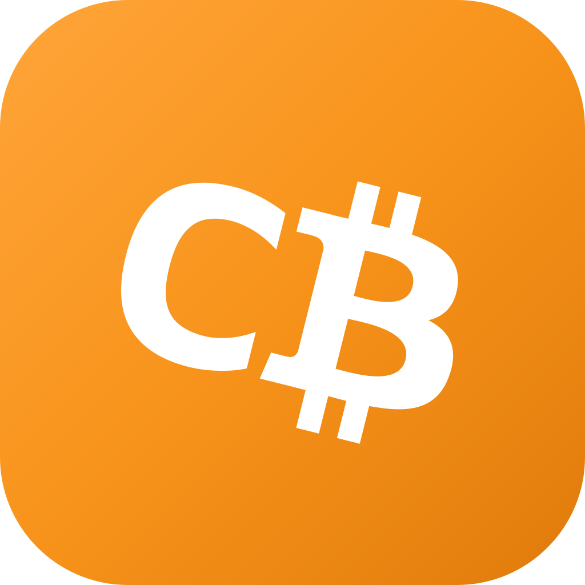
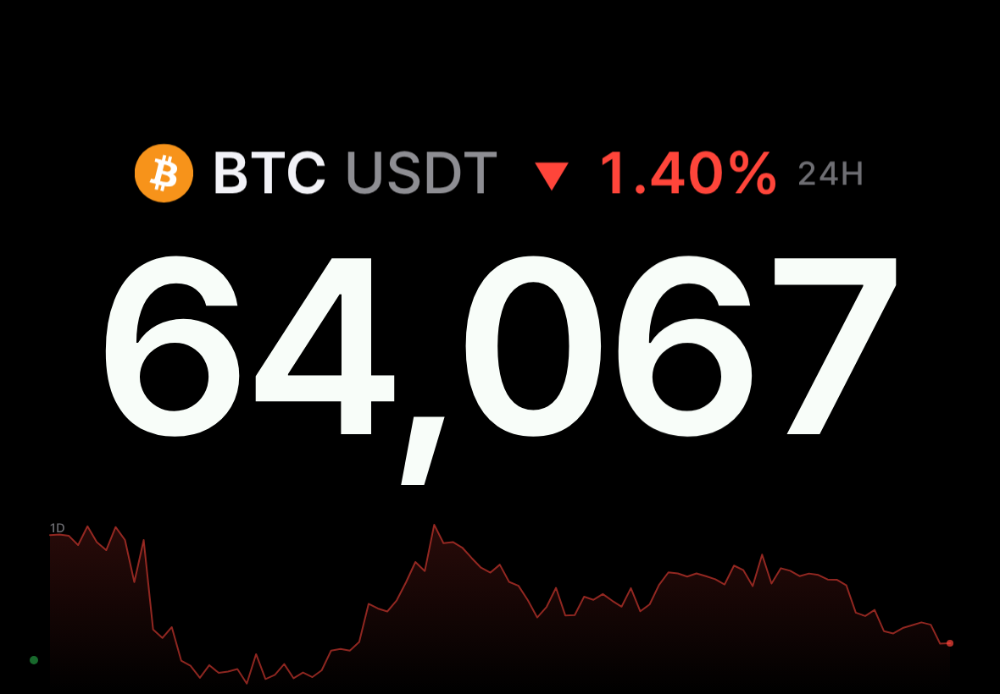
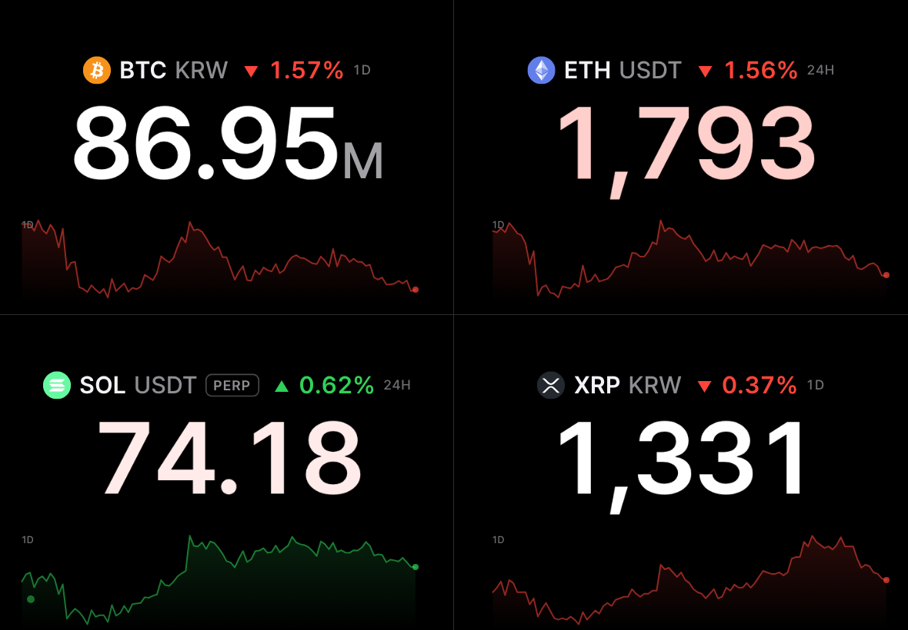

<h1 align="center">Coinboard</h1>

English · <a href="README.ko.md">한국어</a>

A crypto price board: live prices from exchange WebSockets, in large type, on a screen that stays on. It is a web app (PWA) made for an always-on iPad, and works on an iPhone or a computer too.

**Open it: https://2jiho.github.io/coinboard/**

- **Markets**: in Korean won, Upbit, Bithumb and Coinone; in USDT, Binance, OKX and Bybit, spot and perpetual futures (marked `PERP`); in US dollars, Coinbase and Kraken. It starts on BTC on Binance.
- **Several assets**: one asset fills the screen; two or more share it in a grid, markets mixed as you like.
- **A calm board**: digits roll only where they change, the tint deepens with the size of the move, and every place changes together on one three-second beat.
- **Made to stay on**: keeps the screen awake, drifts slightly against burn-in, dims on request, runs offline and updates itself.
- **In your language**: settings in English or Korean, following the device; won in millions (`89.96M`) in English, in 억 and 만 in Korean.
- **Private**: no account, no server of its own, no tracking. Settings stay on your device.

## Quick start

1. Open https://2jiho.github.io/coinboard/ in Safari (iPad, iPhone) or Chrome.
2. Add it to the home screen: Share → **Add to Home Screen** on iOS, ⋮ → **Install app** on Android.
3. Open it from the home screen. Tap once to show the settings button (bottom right) and choose your assets.

## Documentation

- [User guide](docs/guide.md): reading the board, settings, keeping it on, troubleshooting
- [Development](docs/development.md): structure, how it works, tests, releases, deployment

## License

[MIT](LICENSE). The font, coin icons and libraries shipped with the app keep their own licenses: see [THIRD_PARTY_NOTICES.md](THIRD_PARTY_NOTICES.md). Market data belongs to the exchanges; Coinboard is not affiliated with any exchange and is not investment advice.
