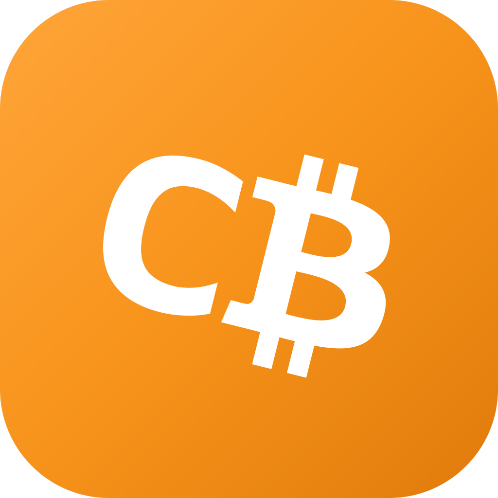

#  Coinboard development

English · [한국어](development.ko.md)

How to use the board is in the [user guide](guide.md). This document is for changing the code or deploying it yourself.

## Development

Node.js 22 or later. Dependencies are kept at their latest stable releases.

~~~bash
npm install
~~~

~~~bash
npm run dev
~~~

Open the address the dev server prints. The service worker is only in the build, so the dev server has no offline or update behavior.

~~~bash
npm run build
~~~

The files to deploy are written to `dist/`. `npm run preview` serves the build.

## Structure

Svelte 5 and Vite. It is a single page, so there is no SvelteKit.

| File | Role |
|---|---|
| `src/App.svelte` | Connects the modules below to the page, and shows and hides the settings button |
| `src/components/PriceBoard.svelte` | The board: one asset large, or a grid of several; layout and sizing; burn-in drift |
| `src/components/PriceBoard.svelte` (`view`) | Also drawn in the small window on top (Document Picture-in-Picture): App mounts a second board there, `view` being that window, which it measures instead of this one |
| `src/components/Price.svelte` | One price line: digits that change as in Apple's apps, and a tint by the size of the move |
| `src/components/SettingsPanel.svelte` | The settings panel (settings only): the asset list and its edit mode, the display card (one row style, every button group 44 px tall), the reset that takes two presses |
| `src/lib/feed.js` | Exchange WebSocket connections (one per market, carrying several coins), reconnection, liveness |
| `src/lib/exchanges/` | Per exchange: addresses (with fallbacks, `hosts`), subscription messages, keep-alive, reading messages (Upbit, Bithumb, Coinone; Binance, OKX and Bybit spot and perpetuals; Coinbase, Kraken). `index.js` lists them and groups them by currency for settings |
| `src/lib/status.js` | Turns the connection state into the words shown |
| `src/lib/quiet-controls.js` | Showing and hiding the row of buttons in the corner (`#board-controls`: update, pop-out, keep screen on, settings), first-tap protection, closing a panel left open |
| `src/lib/presets.js` | The coins offered in settings |
| `src/lib/markets.js` | The coins an exchange lists (for ticker completion and checking) |
| `src/lib/pace.js` | Spacing of requests to an exchange (shared by price connections and coin lists) |
| `src/lib/steady.js` | One three-second beat for the whole board |
| `src/lib/history.js` | Past prices for the line chart: the period's candle size, asking each exchange (`candles` in its definition) in turn with its price connection (the pacer: Upbit refuses a browser's second request within 10 seconds, candles included), at most every 10 minutes; `extend` carries a chart along with the live price in between |
| Clock (`#clock` in `PriceBoard.svelte`) | The time, centred at the top: the device's clock and time zone, 24-hour, renewed on the minute. It takes the board's float, but rises no further than the gap above it, so it never leaves the screen; it sits under the brightness veil. Its size is 7.2% of the screen's short side (26-84px). In the grid, cells and the chart layer start below a band as tall as the clock (`--clock-band`). Setting `clock` (on by default) |
| `src/lib/swipe-brightness.js` | Brightness by swiping: one finger drawn up brightens, down dims (60% of the screen's height is the whole 10-100% range, in steps of 5), shown as a sun and the level on a soft shade in the middle (`#brightness-hud`, not dimmed with the board, and covering nothing else, so the board shows the brightness it will keep). It starts after 8px, and not for a mostly sideways drag; a second finger or a cancelled touch puts the brightness back; a drag that starts on the controls or the panel is not one. Zoom is refused with `touch-action: none` (the panel `pan-y`), a `user-scalable=no` viewport, and iOS's `gesturestart` refused. Brightness itself is the opacity of a black veil over the board (`#dim`), not a filter, so changing it redraws nothing |
| `src/components/Spark.svelte` | The line chart behind the lower board |
| `src/lib/move.js` | The size of a price move (faint, normal, full tint) |
| `src/lib/format.js` | Price and change strings |
| `src/lib/settings.js` | Loading, checking, saving and resetting settings (`reset`: back to the defaults, with the saved entry removed). The chart is saved as `chart` (on or off) and `period` (kept while off); the older form (`chart: "off"` or a period) is read too. `keepAwake` (keep the screen on, on by default) |
| `src/lib/wake-lock.js` | Keeping the screen on. Switched off with `setEnabled(false)`, it lets the lock go, reports `off` and asks for nothing (tap, retry, coming back) until switched on |
| `src/lib/install.js` | Whether and how to offer adding to the home screen (steps on iOS, the browser's install prompt elsewhere) |
| `src/lib/updater.js` | Service worker registration, version checks, applying updates |
| `src/sw.js` | Source of the offline service worker |
| `src/app.css` | Styles: Tailwind and the theme at the top, then the board's plain CSS |
| `src/lib/components/ui/` | shadcn-svelte components (settings panel) |
| `src/lib/utils.js` | Combining the components' class names (`cn`) |
| `components.json`, `jsconfig.json` | shadcn-svelte settings and the `$lib` path |
| `messages/ko.json`, `messages/en.json` | Text for settings and the like (Korean, English) |
| `project.inlang/settings.json` | Translation settings (languages, base language, message format) |
| `public/icons/home-icon.svg` | The app icon; `npm run icons` draws the PNG icons from it |
| `public/favicon.svg` | The browser tab icon (the app icon with rounded corners) |
| `src/paraglide/` | Code generated from the messages by `npm run i18n`, for the unit tests (not in git; do not edit) |

The modules in `src/lib` are plain JavaScript that knows nothing of Svelte or the DOM, and have unit tests.

## How it works

- **Liveness**: judged only by when this device received something, never by comparing the exchange's clock with the device's, so a wrong device clock does not stop prices. Nothing received for 15 seconds means reconnect.
  - Upbit sends a ticker only when a trade happens. The app sends a text `PING` on connecting and every 10 seconds, and takes the `{"status":"UP"}` Upbit sends every 10 seconds as a sign of life, so a quiet market keeps its connection.
  - Binance has no sign of life visible to a browser, so only tickers count.
- **Request spacing**: Upbit accepts a request from a browser once every 10 seconds, counting both price connections and coin lists. Both therefore share one pacer (`src/lib/pace.js`), set to 11 seconds: at exactly 10, network delay makes the gap look shorter at Upbit's end, the request is refused (429), and the refusal counts too, so the next try is refused as well. A connection that is working, or still being made, is not cut when the app comes back into view or the page first loads. Binance gets 2 seconds. A failed connection is retried after 1 second, doubling up to 30. A coin list asked for right after connecting can take up to 11 seconds.
- **Display pace**: prices may arrive many times a second, at a different moment for each coin, but the board changes on one beat, at most every three seconds. On the beat every place with a newer price changes at once, each to the latest price it was sent (`src/lib/steady.js`). A place's first price (on opening, or just after an asset is added or changed) is shown at once.
- **Tab title**: the tab shows the price and market too, as in `8996만 | BTCKRW | Coinboard`, at the same pace as the board. The connection is kept while another tab is in front, so the title stays live; it is closed only when the page is left.
- **Digits**: only the digits that change move, as numbers do in Apple's apps: the old digit drifts 38% of its height away, blurring and fading, while the new one drifts in from the other side and sharpens (0.56 s); upwards when the price rose, downwards when it fell. Nothing clips them. The old digit is a copy laid over its slot (`.digit-old`, drawn by CSS from `data-digit`), so it never enters the price's text, and it is removed when its fade ends. The whole price is tinted with the up or down color for a moment and fades back. The depth of the tint follows the move since the last price shown: under 0.02% faint, under 0.1% normal, 0.1% or more full. How long the tint is held follows the move too: 0.5 s when slight, 1.2 s when ordinary, and from 2.5 s when large, growing to 3 s at 0.5% or more, before it fades back over 2 s (`src/lib/move.js`). With a chart shown, the live price has a small point, and each time the price shown changes the point sends out a ring in the move's color, as wide and as long as the same three steps say (`src/components/Spark.svelte`). The chart is drawn 5% in from each side (on the right so point and ring are not cut by the screen or the cell, on the left to match); line and fill end at the live price's point, past which there are no prices.
- **One connection per market**: the assets of one market share one connection. Upbit takes several coins in one subscription; Binance uses a combined stream (`/stream?streams=…`) when there is more than one coin. Adding, removing or changing an asset keeps the connection open and changes what it carries: Upbit takes a new subscription, which replaces the old one and is answered at once with each coin's current ticker; Binance takes `SUBSCRIBE`/`UNSUBSCRIBE` messages. So a new coin appears within a second or two, and the assets that stay keep receiving. Only a market with no connection yet, or a connection that failed, connects anew (on Upbit at most once per 11 seconds).
- **A ticker that does not exist**: two first-price timeouts in a row with no price ever received turn the dot yellow with `CHECK TICKER`; reconnecting goes on. When several assets share a connection and the others are receiving prices, a coin that receives nothing for 15 seconds is marked `CHECK TICKER` on its own and the connection is kept. A coin added to an open connection that receives nothing for 15 seconds is first asked for again on a new connection carrying everything; only after that can it be marked.
- **Layout, one asset**: one small line above the price (icon, coin, currency, change), then the price, large; centred in either orientation, with the price line at the vertical center. The charts do not float with burn-in protection: what they draw keeps changing, so they need none, and held still they reach the screen's edges. One asset's (`#board-chart`) starts below the lowest the price line can float to and runs to the bottom edge. In the grid, a still layer with the board's own grid (`#chart-grid`) holds one per cell, starting below the price line and kept, on the sides where a floating line between cells can come, that far in. With a chart shown the cell's text rises by 9% of the cell to give it room.
- **Grid, two or more assets**: the whole screen is divided into cells of one size, with faint lines only between cells, running edge to edge (no outer border). Each cell centers an icon, coin and currency, price and change, and every price is drawn at one size (the size the longest needs). In `자동` (automatic) mode, of the layouts with the same number of cells in every row that follow the screen (landscape: no more rows than columns; portrait: the reverse), the one with the largest type is used; a count with no such layout (5, 7, ...) is one line. In landscape, for example, 4 are 2 × 2, 6 are two rows of three, 5 are one row. Cells per row can be set by hand (1 to 6); a short last row keeps to the columns above, its leftover places empty. The first asset is top left, and the tab title uses the first asset.
- **Price format**: always at least four significant figures, with no decimals that add nothing. The currency code is on the line above the price. The table is for a device in Korean:

  | Won | Example | USDT | Example |
  |---|---|---|---|
  | 1억 and up | `1억 2340만` | 1,000 and up | `70,123` |
  | 1000만 to 1억 | `8934만` | 100 to 999 | `152.3` |
  | 100만 to 1000만 | `451.2만` | 10 to 99 | `98.77` |
  | 100 to 100만 | `152,300`, `215` | 1 to 9 | `2.346` |
  | Under 100 | `12.34` | Under 1 | `0.6234` |

  On a device in English, won from a million up is written as `89.96M` or `1.235B`, with four significant digits (`Intl.NumberFormat`'s compact notation).
- **Keeping the screen on**: when the system releases the wake lock, it is asked for once more. If that one is released again within 5 seconds, the app stops and the dot shows `SCREEN MAY SLEEP`; a tap, or coming back to the app, asks again. A device without the feature is told by the keep-screen-on button beside the settings button (a yellow mark; a press says why), not by the dot. Switched off by the owner (`keepAwake: false`), the lock is let go and nothing warns.
- **Updates**: checked every 30 seconds while the screen is visible (each check asks only whether the small worker file changed, bypassing the browser cache: `updateViaCache: "none"`), and on coming back to the app or getting the network back. A new version reloads the page at once, or, if the settings panel is open, once it is closed. With the same version the page reloads itself once per browser session; after that only the `Update Now` (`새 버전 적용`) button is offered.
- **Burn-in protection** (for OLED; `body.oled` while on): every minute the board glides to a new spot near the centre (within 3% of each side; half that for a grid, whose cells reach the screen's edges). The price is off-white (`--price-white`), the status dot hides while all is well (`.quiet`), and a price that is not current is dimmed further. Switched off, none of this applies and the board sits in the middle.
- **Settings button and touch**: a tap or Tab shows the settings button and the buttons beside it together; after 5 seconds untouched they fade out over 0.6 seconds. The tap that shows them presses none of them, but a press while it fades goes through (`src/lib/quiet-controls.js`). `touch-action: manipulation` keeps iOS from taking two quick taps as a double-tap zoom, and text selection and the long-press callout are off everywhere except the ticker fields. The settings panel hangs from the top, so a status line appearing or going below does not move the row under the finger.
- **Offline and start-up**: every built file is stored as one set on installation, and the page opens from that copy at once. A new release is downloaded in the background and applied as above. Prices are never stored.
- **Font**: [Pretendard](https://github.com/orioncactus/pretendard) (SIL Open Font License) ships with the app so it looks the same on every device: subset files with Latin, digits and the 2,350 common Hangul syllables, three weights (about 800 KB), installed with the other files and available offline.
- **Coin icons**: icons for 483 coins are in `public/coins/`, so no outside server is needed ([cryptocurrency-icons](https://github.com/spothq/cryptocurrency-icons), CC0). The six coins offered in settings are installed with the app; the rest are fetched and stored the first time they are shown. A coin with no icon is shown without one.

## Design

- **Settings panel**: built with [Tailwind CSS](https://tailwindcss.com) 4 and [shadcn-svelte](https://shadcn-svelte.com) components (maia style). The components are not a library: their code is copied into `src/lib/components/ui/` and edited there (the switch and the slider are enlarged to iPad size). Market, columns and colors are button groups (`toggle-group`); the coin uses `native-select`, so the iPad's own picker opens. Reordering by the drag handle is done in `SettingsPanel.svelte` with pointer events, no library (mouse, touch, and arrow keys). Assets are added and deleted, never edited in place; a delete can be undone from its toast.
- **Theme**: the color, radius and font variables at the top of `src/app.css` are the theme of the panel and the components. The app is always dark.
- **The board**: plain CSS in `src/app.css`, not Tailwind: fixed zones scaled to the screen need calculation and fine tuning. Board elements must not use class names that are Tailwind utilities (`grid`, `hidden`, `flex` and so on): Tailwind would style them and break the layout.
- **Adding components**: `npx shadcn-svelte@latest add <name>`. When a new component brings a library into the app, add it to [THIRD_PARTY_NOTICES.md](../THIRD_PARTY_NOTICES.md) and `public/licenses/`.
- **App icon**: a C and the Bitcoin ₿, upright side by side, the pair leaning 14° together as the Bitcoin logo does, white on Bitcoin orange. The ₿ comes from the Bitcoin logo; the C is from [Maven Pro](https://github.com/m4rc1e/mavenproFont) Bold, the typeface whose B is closest to the ₿, sized so that its B would be the ₿'s body. Both are outlines in `public/icons/home-icon.svg`, so no font is needed to draw it. After changing that file, run `npm run icons` to redraw the PNGs (iPhone and iPad home screen, Android and install icons) and update `public/favicon.svg` to match. The mark stays inside the central circle that maskable icons keep.
- **Content Security Policy**: everything works under the CSP that blocks inline styles and scripts; the browser tests fail on any CSP violation.

## Translation

The settings panel, state descriptions and messages are translated with [Paraglide JS](https://github.com/opral/paraglide-js) (3.x, MIT). Messages live under keys named by meaning in `messages/ko.json` and `messages/en.json`, and are compiled into functions at build time, so only the messages in use ship. Code calls them as `m.settings_title()` or `m.status_retry({ reason, seconds })`.

- **Choosing the language**: the device's preferred languages (`navigator.languages`); English when neither Korean nor English is found. Nothing is stored and there is no setting.
- **Not translated**: the board (tickers, prices, `KRW`, `USDT`, `PERP`, `1D`, `24H`, the status dot's words) is the same in every language, except how won prices are written (see the price format above).
- **Plurals**: text that changes with a number, like `1 second` and `2 seconds`, uses a `plural` selector in the message file.
- **Changing or adding messages**: change both files. `npm test` checks that both have the same keys and values, that none is empty and that the English has no Korean in it; the browser tests check, on an English device, that no Korean is left in the settings panel and that no choice is cut off.
- **Compiling**: `npm run build` and `npm run dev` compile in memory through the Vite plugin (virtual modules); `npm test` first runs `npm run i18n`, which writes `src/paraglide/`. The message-format plugin is fetched from jsDelivr, so the first compile needs the internet.
- **Terms**: 자산 = Asset, 시장 = Market, 원화 = KRW, 달러 = USD, 코인 = Coin, 티커 = Ticker, 직접 입력 = Other, 가로 칸 수 = Columns, 밝기 = Brightness, 번인 방지 = Burn-in Protection, 등락 색 = Up/Down Colors, 무기한 = Perpetual.

## Versions

`major.minor.patch`, written only in `version` in `package.json`. The build puts it on screen and into the service worker.

~~~bash
npm version patch --no-git-tag-version
~~~

Fixes bump `patch`, features `minor`. When a change with a new version reaches main and is deployed, a tag such as `v1.2.3` and a GitHub release are made automatically, with notes from the titles of the pull requests merged since. A change that does not bump the version makes no release. A deployment must bump it, or the version shown in settings and the cache name do not change. Settings normally show `버전 1.2.3` (version) alone, and both versions, as in `버전 1.2.3 · 설치된 사본 1.2.4` (installed copy), only when the page and the installed offline copy differ.

## Tests

~~~bash
npm test
~~~

~~~bash
npx playwright install chromium
~~~

~~~bash
npm run test:e2e
~~~

- `npm test`: unit tests for the modules in `src/lib`.
- `npm run test:e2e`: builds, then checks the real page in Chromium. Exchanges and the wake lock are scripted; screenshots are left in `evidence/` (not in git). The scenarios run four at a time, each against its own local server (`E2E_JOBS` sets how many; `E2E_JOBS=1` runs them one by one); about 40 seconds on a laptop.
  - The board and settings panel, keyboard use (Tab reaches settings first), delayed, failing and offline prices
  - The buttons beside the settings button: keeping the screen on (switched off and on, retried in trouble, its icon and name), the pop-out, messages above the row, the row fading after a press
  - Settings at 360 px in Korean and English: nothing cut off, the display card's order, every choice a 44 px target, keyboard deleting keeps focus
  - Reset: one press asks, two bring back a new board's settings, with editing or the add form open
  - The chart: switched off and on with its period kept, and a board saved before the switch
  - The grid: adding, cancelling and refusing duplicates, reordering by drag handle and by keyboard, deleting and undoing, live prices in the list, one connection per market, cell and type size, a coin that never answers, layouts by orientation, cells per row, back to one asset, reading settings saved before the grid
  - The first connection is kept when the page loads; a page shown again reconnects
  - An English device: no Korean left in settings, no choice cut off, won in millions, the page's language
  - Updates applied by themselves (with the settings panel open, and with nobody touching the board)
  - Storage that cannot be used
  - Running offline; layout at 8 screen sizes and safe-area combinations
- `LIVE_NETWORK=1` also connects to the real exchanges. `CHROME_PATH` selects another Chrome.

## Deployment

A push to `main` runs the tests in GitHub Actions and, if they pass, publishes the build to GitHub Pages. Pull requests run the tests too (a newer push to one cancels the run before it); a branch push alone does not. The browser tests use the Google Chrome already on GitHub's runner, so nothing has to be installed for them. The repository's Settings → Pages → Source must be "GitHub Actions".

## Known limits

- **Automated tests run in Chromium only**: the iPadOS and iOS status bar and layout, keeping the screen on and touch handling in a home-screen app, and running for days are checked on real devices. It is made for current iPadOS and iOS; older devices are not considered.
- **Binance region restrictions**: where Binance is blocked (the United States, for one), Binance market prices do not arrive.
- **Thinly traded Binance coins**: a coin with no price change for more than 15 seconds may reconnect repeatedly.
- **Keeping the screen on**: if the system refuses (Low Power Mode, for example), the app cannot force it.

## Official APIs

- [Upbit ticker](https://docs.upbit.com/kr/reference/websocket-ticker): `wss://api.upbit.com/websocket/v1`, ticker subscription.
- [Upbit rate limits](https://docs.upbit.com/kr/reference/rate-limits): connection requests from a browser (with an Origin) once every 10 seconds (the app uses 11).
- [Upbit connection management](https://docs.upbit.com/kr/docs/websocket-best-practice): closed after 120 seconds idle; kept with PING.
- [Binance market streams](https://developers.binance.com/en/docs/products/spot/web-socket-streams): `wss://data-stream.binance.vision/ws/<symbol>@ticker`, Binance's market-data-only host (the coin list from `https://data-api.binance.vision`). It carries the same streams as `stream.binance.com` and is reachable where binance.com itself is restricted. Futures have no such host.
- [Bithumb WebSocket](https://apidocs.bithumb.com/reference/websocket-기본-정보): `wss://ws-api.bithumb.com/websocket/v1`, Upbit's format. It has no keep-alive answer and sends a ticker only on a trade, so the subscription is sent again every 10 seconds; Bithumb answers it with each coin's current ticker.
- [OKX tickers channel](https://www.okx.com/docs-v5/en/#public-data-websocket-tickers-channel): `wss://ws.okx.com/ws/v5/public` on port 443 (the documented 8443 is closed on many networks), then `wss://wseea.okx.com/ws/v5/public`. `ping` every 20 seconds, answered `pong`. An unknown instrument is refused alone (code 60018). Coin lists from `/api/v5/public/instruments` (`www.okx.com`, then `my.okx.com`).
- [Coinbase Exchange WebSocket feed](https://docs.cdp.coinbase.com/exchange/websocket-feed/channels): `wss://ws-feed.exchange.coinbase.com`, `ticker` and `heartbeat` channels (a heartbeat every second keeps it alive). An unknown product is refused alone. Coin list from `https://api.exchange.coinbase.com/products`.
- [Bybit tickers](https://bybit-exchange.github.io/docs/v5/websocket/public/ticker): `wss://stream.bybit.com/v5/public/spot` and `/linear`, one `tickers.<symbol>` a request (a request naming an unlisted coin is refused whole), `{"op":"ping"}` every 10 seconds. Perpetuals send a full ticker, then only changed fields; the last 24-hour change is kept for a price that comes alone. REST (coin list, candles) at `api.bybit.com`, then `api.bytick.com`; Bybit blocks some regions (the US) by address.
- [Kraken WebSocket v2](https://docs.kraken.com/api/docs/websocket-v2/ticker): `wss://ws.kraken.com/v2`, `ticker` channel, `BTC/USD` names; a heartbeat every second once subscribed. An unknown pair is refused alone. Coin list from `/0/public/AssetPairs` (its `wsname` still says `XBT` and `XDG` for BTC and DOGE), candles from `/0/public/OHLC`.
- [Coinone WebSocket](https://docs.coinone.co.kr/reference/public-websocket-1): `wss://stream.coinone.co.kr`, one `TICKER` subscription a coin, `PING` every 10 seconds. An unknown coin is answered `Invalid Topic` without saying which, so it is left waiting. Coinone's REST API sends no CORS headers: no coin list and no chart.
- **Fallback addresses**: an exchange may list several addresses (`hosts`); a connection that fails before receiving anything moves on to the next. Coin lists try their addresses in turn.
- [Binance USDⓈ-M futures streams](https://developers.binance.com/docs/derivatives/usds-margined-futures/websocket-market-streams): `wss://fstream.binance.com/market/ws/<symbol>@ticker`. Since 23 April 2026 the old address without the `/market` path delivers no tickers.

## License and notices

The code is under the [MIT License](../LICENSE). The licenses of the font, coin icons and libraries shipped with the app are listed in [THIRD_PARTY_NOTICES.md](../THIRD_PARTY_NOTICES.md); the full texts are in `licenses/` of the deployed site (source: `public/licenses/`) and in `coins/LICENSE.md`. Changing dependencies can change what ends up in the build, so check the notices too.

## Documentation

The user guide and this document exist in Korean (`*.ko.md`) and English. When behavior changes, update both. Screenshots for the guide are in `docs/images/`.
