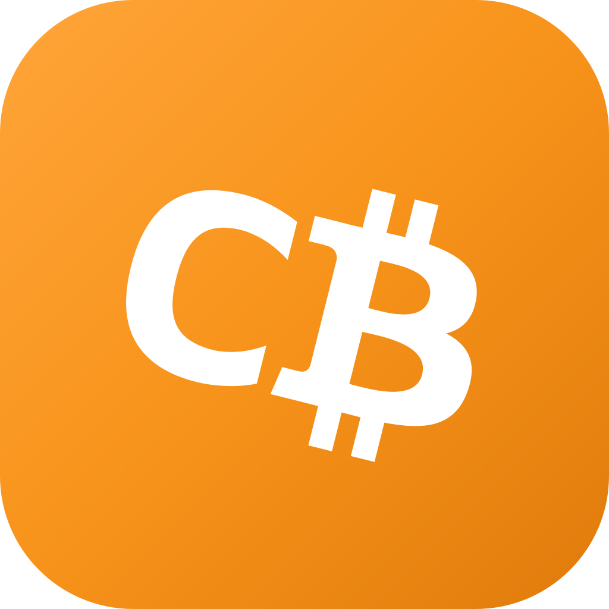
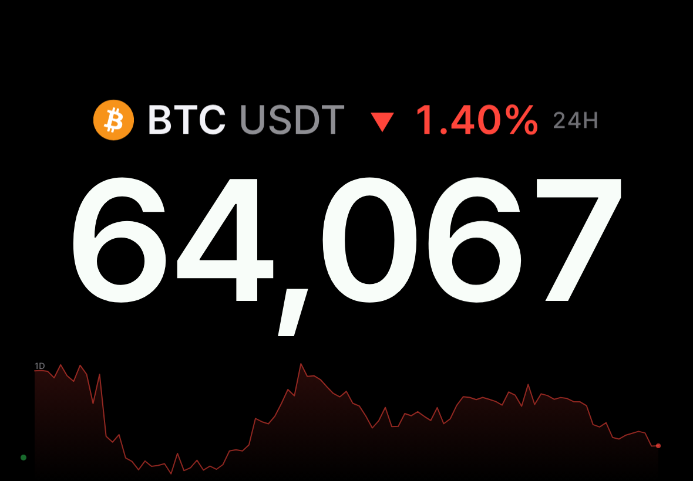
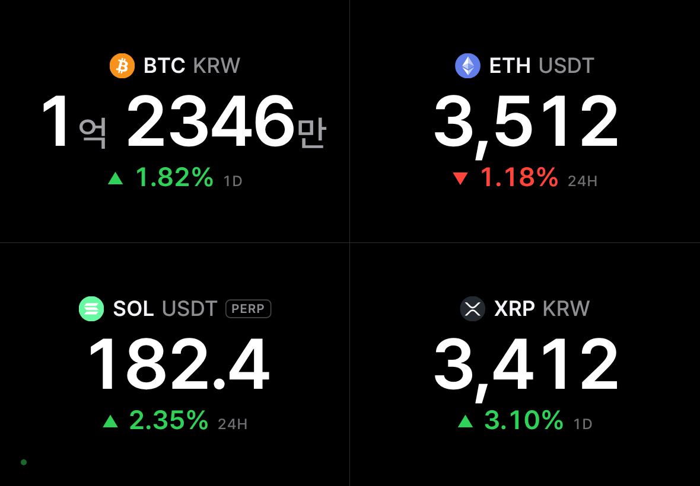
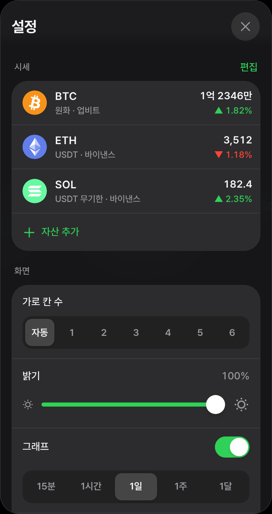

#  Coinboard 사용 설명서

[English](guide.md) · 한국어

Coinboard는 코인 시세를 크게 띄워 두는 전광판입니다. 아이패드나 아이폰, 컴퓨터 브라우저에서 열고, 항상 켜 두는 화면으로 쓰는 것을 기준으로 만들었습니다. 계정이나 설치 파일은 필요 없습니다.

- 주소: https://2jiho.github.io/coinboard/
- 처음 열면 **바이낸스 BTC**(USDT 현물)를 보여 줍니다.

## 목차

1. [시작하기](#시작하기)
2. [화면 읽는 법](#화면-읽는-법)
3. [여러 자산 보기(그리드)](#여러-자산-보기그리드)
4. [설정](#설정)
5. [항상 켜 두기](#항상-켜-두기)
6. [업데이트](#업데이트)
7. [문제 해결](#문제-해결)
8. [데이터와 개인정보](#데이터와-개인정보)

## 시작하기

브라우저에서 주소를 열면 바로 시세가 나옵니다. 전광판으로 오래 쓰려면 **홈 화면에 추가**해서 앱처럼 여는 것을 권합니다. 그러면 주소창 없이 전체 화면으로 열리고, 인터넷이 끊겨도 앱이 열립니다(시세는 연결되면 다시 들어옵니다). 브라우저에서 열면 설정 창 맨 위에 방법이 나옵니다. 아이폰·아이패드에서는 아래 순서가, Chrome·Edge에서는 **설치** 버튼이 나옵니다.

**아이패드·아이폰 (Safari)**

1. Safari로 주소를 엽니다.
2. 공유 버튼(네모에 위쪽 화살표)을 누릅니다.
3. **홈 화면에 추가**를 고르고 **추가**를 누릅니다.
4. 홈 화면의 **Coinboard** 아이콘으로 엽니다.

**안드로이드 (Chrome)**

1. Chrome으로 주소를 엽니다.
2. 오른쪽 위 메뉴(⋮)에서 **앱 설치** 또는 **홈 화면에 추가**를 고릅니다.

**컴퓨터**

브라우저에서 열고 전체 화면(F11, macOS는 Control+Command+F)으로 두면 됩니다. Chrome·Edge는 주소창 오른쪽의 설치 아이콘으로 앱처럼 설치할 수도 있습니다.

## 화면 읽는 법

전광판에는 꼭 필요한 것만 보입니다. 전광판의 글자는 원화 가격의 `억`, `만`을 빼면 모두 영어입니다. 설정 창은 기기 언어를 따라, 한국어 기기에서는 한글, 그 밖에는 영어로 보입니다.

| 보이는 것 | 뜻 |
|---|---|
| 아이콘과 `BTC` | 코인 |
| `KRW` / `USDT` | 가격의 통화. 업비트는 원화, 바이낸스는 USDT이고, 달러로 환산하지 않습니다 |
| `PERP` | 바이낸스 USDT 무기한 선물 |
| 큰 숫자 | 마지막 체결 가격 |
| `▲ 1.42%` / `▼ 0.64%` | 등락률 |
| `1D` | 전일 대비(업비트) |
| `24H` | 최근 24시간 대비(바이낸스) |

**가격 표기**: 숫자를 항상 4자리 이상 보여 주고, 필요 없는 소수는 붙이지 않습니다.

| 원화 | 예 | USDT | 예 |
|---|---|---|---|
| 1억 이상 | `1억 2340만` | 1,000 이상 | `70,123` |
| 1000만 ~ 1억 | `8934만` | 100 ~ 999 | `152.3` |
| 100만 ~ 1000만 | `451.2만` | 10 ~ 99 | `98.77` |
| 100 ~ 100만 | `152,300` | 1 ~ 9 | `2.346` |
| 100 미만 | `12.34` | 1 미만 | `0.6234` |

영어 기기에서는 원화를 `123.5M`, `1.235B`처럼 백만(M)·십억(B) 단위로 씁니다.

**가격이 바뀔 때**

- 바뀐 자리의 숫자만 계수기처럼 굴러갑니다. 오르면 아래에서 위로, 내리면 위에서 아래로 움직입니다.
- 가격 전체가 잠깐 상승·하락 색으로 물듭니다. 직전 가격 대비 움직임이 클수록 진합니다: 0.02% 미만은 옅게, 0.1% 미만은 보통, 0.1% 이상은 가장 진하게 조금 더 오래 물듭니다.
- 화면은 3초에 한 번까지만 바뀌고, 여러 자산이 있으면 새 가격이 온 칸이 모두 같은 순간에 바뀝니다. 그 사이에 온 가격 중 가장 최신 것을 보여 줍니다.

**상태 점**: 화면 왼쪽 아래 구석의 작은 점이 연결 상태를 알려 줍니다. 터치 화면에서는 점을 누르면, 마우스는 점에 올리면 자세한 내용이 뜹니다.

| 색 | 뜻 |
|---|---|
| 초록 | 정상 |
| 노랑 | 연결 중, 시세 지연, 티커 확인 필요, 화면 켜짐 유지가 꺼짐 |
| 빨강 | 오프라인, 거래소 오류 |

| 자세한 내용 | 뜻 |
|---|---|
| `LIVE` | 실시간으로 받는 중 |
| `WAITING` | 연결하고 첫 시세를 기다리는 중 |
| `DELAYED` | 시세가 잠시 끊겨 다시 연결하는 중 |
| `LAST PRICE` | 지금 보이는 가격은 마지막으로 받은 가격 |
| `OFFLINE` | 인터넷 연결이 없음 |
| `ERROR` | 거래소가 오류를 보냄 |
| `CHECK TICKER` | 그 코인의 시세가 오지 않음. 그 시장에 없는 코인일 수 있음 |
| `SCREEN MAY SLEEP` | 화면 켜짐 유지가 풀려 화면이 꺼질 수 있음 |

문제가 있는 동안에는 가격이 흐리게 보입니다(여러 자산이면 문제가 있는 칸만). 브라우저 탭 제목에도 `70,123 | BTCUSDT | Coinboard`처럼 첫 자산의 가격이 나옵니다.

## 여러 자산 보기(그리드)

자산을 둘 이상 넣으면 화면 전체를 같은 크기의 칸으로 나눕니다. 칸 사이에는 희미한 선이 있고, 모든 칸의 글자 크기는 같습니다. 시장을 섞어도 됩니다.

- **자동 배치**(기본): 모든 줄의 칸 수가 같은 배치 중에서 글자가 가장 크게 나오는 것을 고릅니다. 가로 화면에서 4개는 2×2, 6개는 3칸씩 2줄입니다. 그렇게 나눌 수 없는 개수(5, 7 등)는 한 줄로 놓습니다.
- **가로 칸 수**를 직접 정할 수도 있습니다([설정](#설정) 참고). 예를 들어 5개를 3칸으로 하면 3개·2개 두 줄이 되고, 남는 자리는 비워 둡니다.
- 첫 자산이 왼쪽 위에 오고, 설정의 자산 목록 순서대로 채워집니다.
- 최대 20개까지 넣을 수 있지만, 칸이 많을수록 글자가 작아집니다.

## 설정

화면을 한 번 누르면 오른쪽 아래에 설정 버튼(톱니바퀴)이 나타납니다. 5초 동안 아무것도 하지 않으면 다시 사라집니다. 버튼을 띄운 첫 탭은 버튼을 누르지 않으니, 버튼이 보이면 한 번 더 누르세요. 키보드에서는 Tab 키로 버튼을 띄웁니다. 앱을 처음 열면 화면 아래에 이 방법이 한 줄로 나옵니다(*화면을 탭하면 설정 버튼이 나타납니다*). 화면을 한 번 건드리면 사라지고 다시 나오지 않습니다.

바꾸는 즉시 적용되고 저장됩니다(자산 추가만 `추가`를 눌러야 들어갑니다).

설정 창은 **시세**와 **화면** 두 묶음으로 나뉩니다.

**홈 화면에 추가**: 브라우저에서 열었을 때만 맨 위에 나옵니다. 아이폰·아이패드에서는 공유 버튼 → `홈 화면에 추가` → `추가` 순서가, Chrome·Edge·Android에서는 **설치** 버튼이 나옵니다. 홈 화면에 생길 앱 아이콘도 함께 보입니다. 오른쪽 위 ✕로 닫으면 그 기기에서는 다시 나오지 않고, 사용법의 `켜 두고 쓰기`에서 다시 볼 수 있습니다. 처음 열 때 나오는 안내 한 줄에도 "홈 화면에 추가하는 방법은 설정에 있습니다"가 덧붙습니다.

**자산 목록**: 전광판에 보일 자산(코인과 시장)이 카드처럼 한 줄씩 있고, 줄마다 코인 아이콘, 지금 가격, 등락률이 함께 보입니다.

- 오른쪽 손잡이(⠿)를 끌어 순서를 바꿉니다. 끄는 동안 다른 줄이 비켜나고, 놓으면 저장됩니다. 그리드에서 왼쪽 위부터 이 순서로 놓입니다. 키보드에서는 손잡이에서 위·아래 화살표로 옮깁니다.
- 줄의 휴지통 아이콘을 누르면 그 자산이 바로 지워집니다. 5초 동안 화면 아래 알림에 **되돌리기**가 나오고, 누르면 원래 자리로 돌아옵니다. 마지막 하나는 지울 수 없습니다.
- 자산은 따로 고치지 않습니다. 다른 코인이나 시장으로 바꾸려면 새 자산을 추가하고 기존 자산을 지웁니다.

**자산 추가**: 누르면 시장과 코인을 고르는 칸이 펼쳐집니다. 고른 뒤 `추가`를 누르고, 그만두려면 `취소`를 누릅니다. 이미 있는 자산은 다시 넣을 수 없습니다.

**시장**(자산 추가 칸): 가격 통화별로 묶은 목록에서 고릅니다. 마지막 자산의 시장에서 시작합니다.

| 통화 | 시장 |
|---|---|
| 원화 | 업비트, 빗썸, 코인원 |
| USDT | 바이낸스 현물, 바이낸스 USDT 무기한 선물, OKX 현물, OKX USDT 무기한, 바이비트 현물, 바이비트 USDT 무기한 |
| 달러 | 코인베이스, 크라켄 |

등락률은 거래소가 주는 기준 그대로입니다. 업비트·빗썸은 전일 종가 대비(`1D`), 나머지는 최근 24시간(`24H`)입니다. 같은 코인·같은 통화를 서로 다른 거래소에서 함께 띄우면, 그 칸에는 거래소 이름도 붙습니다.

**코인**(자산 추가 칸): 자주 쓰는 여섯 코인(BTC, ETH, XRP, SOL, DOGE, ADA)이 목록에 있습니다. 다른 코인은 `직접 입력…`을 고르고 티커(예: `LINK`)를 입력한 뒤 Enter나 `추가`를 누릅니다. 입력하는 동안 그 거래소에 실제로 상장된 코인으로 자동 완성되고, 없는 티커는 알려 줍니다. 코인원은 코인 목록을 웹페이지에 내주지 않아 자동 완성이 없고, 없는 티커는 가격이 `—`로 남습니다.

**가로 칸 수**: 자산이 둘 이상일 때만 보입니다. `자동 1 2 3 4 5 6` 버튼 중에서 누릅니다. 1이면 모두 세로 한 줄입니다.

**밝기**: 양옆에 작은 해·큰 해가 있는 슬라이더입니다. 화면을 어둡게 하는 필터이고(10~100%), 기기 자체의 밝기는 바꾸지 않습니다.

**번인 방지**: OLED 화면용입니다. OLED는 오래 켜져 있던 자리가 닳아 자국이 남지만, LCD 화면은 번인이 생기지 않아 꺼도 됩니다. 기본으로 켜져 있고, 켜 두면 다음이 적용됩니다.

- 1분마다 전광판이 아주 조금씩 자리를 옮깁니다(화면의 3% 이내).
- 가격은 순백색 대신 따뜻한 미색으로 그립니다.
- 상태 점은 정상일 때 숨깁니다. 문제가 있을 때와 설정 버튼이 보일 때만 나옵니다.
- 지연·오프라인으로 최신이 아닌 가격은 더 흐리게 그립니다.

그 밖에는 아무것도 어둡게 하지 않습니다. 전광판은 한눈에 읽히도록 늘 또렷하게 켜 둡니다.

끄면 예전과 똑같이 보입니다.

**화면 켜짐 유지**: 앱이 지금 화면을 켜 두고 있는지 보여 줍니다. 켜 두는 동안은 **작동 중**(초록 점), 풀렸으면 **꺼짐**(노랑 점)이고 아래에 이유와 다시 시도 버튼이 나옵니다. 앱이 뒤로 가 있으면 **대기 중**, 브라우저가 지원하지 않으면 **지원 안 됨**입니다.

**작은 창으로 띄우기**(PC의 Chrome·Edge만): 전광판을 다른 창 위에 늘 떠 있는 작은 창으로 띄웁니다. 창 크기에 맞춰 같은 전광판을 그리고, 가격도 같은 연결로 받습니다. 위치와 크기는 마음대로 바꿀 수 있고, 같은 버튼(`작은 창 닫기`)을 누르거나 창을 닫으면 끝납니다. 탭을 닫으면 함께 닫힙니다. 다른 브라우저에는 이런 창이 없어서 버튼이 보이지 않습니다.

**그래프**: 등락률 옆에 기간 동안의 가격을 작은 선 그래프로 그립니다. **끔**, **15분**, **1시간**, **1일**(기본), **1주**, **1달** 중에서 고릅니다. 거래소의 과거 시세(봉)로 그리고 마지막 점은 실시간 가격입니다. 기간 동안 올랐으면 상승 색, 내렸으면 하락 색입니다(등락 색 설정을 따름). 전광판에는 기간이 `15M`, `1H`, `1D`, `7D`, `30D`로 적힙니다. 업비트·빗썸의 등락률은 전일 종가 대비이고 `1D` 그래프는 최근 24시간이라, 둘의 방향이 다를 수 있습니다. 과거 시세를 받을 수 없는 경우(차단 지역의 바이낸스 선물·바이비트 등)에는 그래프가 나오지 않습니다. 코인원은 과거 시세를 웹페이지에 내주지 않아 그래프가 없습니다. 업비트는 브라우저의 요청을 10초에 한 번만 받기 때문에, 업비트 그래프는 시세가 뜬 뒤 10초 남짓 간격으로 하나씩 나타납니다.

**등락 색**: 실제 색으로 그린 견본 두 개 중에서 누릅니다. `초록 · 빨강`(상승 초록, 하락 빨강) 또는 한국식 `빨강 · 파랑`(상승 빨강, 하락 파랑).

**맨 아래**: 앱 아이콘과 이름, 버전, **사용법**을 여는 물음표, 소스 코드로 가는 GitHub 아이콘. 사용법은 이 설명서를 줄인 앱 안의 안내(설정 열기, 상태 점, 여러 자산, 전광판 읽기, 켜 두고 쓰기)이고, 이 설명서로 가는 링크가 있습니다. 위쪽 화살표를 누르면 설정으로 돌아갑니다.

연결이나 화면 켜짐 유지에 문제가 있을 때만 사유와 `다시 시도` 버튼이 나타납니다. 설정 창은 닫기 버튼, 창 바깥 누르기, Escape 키로 닫고, 2분 동안 만지지 않으면 스스로 닫힙니다.

## 항상 켜 두기

전광판으로 계속 띄워 두려면 다음을 권합니다.

- **홈 화면에 추가해서 열기**: 전체 화면으로 열리고 화면 켜짐 유지가 가장 잘 동작합니다.
- **충전기 연결**: 화면이 계속 켜져 있으므로 배터리로는 오래 못 갑니다.
- **저전력 모드 끄기**: 저전력 모드에서는 화면 켜짐 유지가 거부될 수 있습니다.
- **자동 잠금**: 앱이 화면을 켜 두지만, 확실하게 하려면 설정 → 디스플레이 및 밝기 → 자동 잠금을 **안 함**으로 둡니다.
- **화면 고정(선택)**: 아이패드의 손쉬운 사용 → **사용법 유도**를 켜면 다른 앱으로 넘어가지 않게 고정할 수 있습니다.
- **번인 방지**: OLED 화면이면 켜 둡니다.

## 업데이트

새 버전은 자동으로 적용됩니다. 화면이 켜져 있는 동안 5분마다 새 버전을 확인하고, 있으면 스스로 새로고침합니다(설정 창이 열려 있으면 닫을 때). 새 버전이 나온 뒤 반영되기까지 보통 5~15분 걸립니다. 바로 적용하려면 설정 창에 `새 버전 적용` 버튼이 보일 때 누르거나, 앱을 닫았다가 다시 엽니다. 지금 버전은 설정 창 맨 아래에 있습니다.

## 문제 해결

**가격이 안 나오고 `—`만 보여요**
처음 열면 몇 초 걸립니다. 업비트는 연결 요청 간격 제한 때문에 최대 11초 걸릴 수 있습니다. 이미 보이는 시장에 코인을 더하거나 바꾸면 1~2초면 나타납니다. 상태 점을 눌러 내용을 확인하세요. `OFFLINE`이면 인터넷 연결을, `ERROR`나 `CHECK TICKER`면 아래 항목을 보세요.

**`CHECK TICKER`가 떠요**
그 시장에 없는 코인일 가능성이 큽니다. 예를 들어 업비트 원화 시장에 없는 코인이거나, 바이낸스 선물에 없는 코인입니다. 설정에서 그 코인이 있는 시장으로 새로 추가하고 이 자산은 지우세요. 거래가 아주 드문 코인도 이렇게 보일 수 있습니다.

**바이낸스 선물 자산만 안 나와요**
바이낸스는 일부 지역(미국 등)에서 막혀 있습니다. 현물 시세는 바이낸스의 시세 조회 전용 주소로 받기 때문에 그 지역에서도 나오지만, 선물 시세와 선물 코인 목록은 안 나올 수 있습니다. 업비트는 영향이 없습니다.

**상태 점이 노랗고 `DELAYED`가 떠요**
시세가 15초 넘게 오지 않아 다시 연결하는 중입니다. 화면에는 마지막 가격이 흐리게 남아 있고, 연결되면 저절로 돌아옵니다. 계속되면 인터넷 연결을 확인하세요.

**`SCREEN MAY SLEEP`이 떠요**
화면 켜짐 유지가 풀렸습니다. 화면을 한 번 누르면 다시 요청합니다. 저전력 모드라면 끄세요. 그래도 안 되면 [항상 켜 두기](#항상-켜-두기)의 자동 잠금 설정을 따르세요.

**설정 버튼이 안 눌려요**
화면을 한 번 눌러 버튼을 띄운 뒤, 버튼이 보이면 눌러야 합니다. 첫 탭은 버튼을 띄우기만 합니다.

**업데이트가 반영되지 않아요**
5~15분 기다리거나, 앱을 완전히 닫았다가 다시 엽니다. 설정 창 맨 아래 버전으로 확인할 수 있습니다.

**설정이 저장되지 않는다고 떠요**
브라우저가 저장소 사용을 막고 있습니다(일부 개인정보 보호 설정이나 저장 공간 부족). 바꾼 설정은 이번 실행에만 적용됩니다. 일반 창이나 홈 화면 앱으로 열고, 브라우저의 웹사이트 데이터 차단 설정을 확인하세요.

## 데이터와 개인정보

- 계정, 로그인, 광고, 분석 도구가 없습니다.
- 시세는 각 거래소(업비트, 바이낸스)의 공개 시세를 브라우저가 직접 받아 보여 줍니다. 중간에 거치는 서버가 없습니다.
- 설정은 그 기기의 브라우저에만 저장되고 밖으로 보내지 않습니다.
- 앱 파일은 GitHub Pages에서 받습니다.
- 시세 데이터의 권리는 각 거래소에 있습니다. Coinboard는 거래소와 관계가 없으며, 표시된 시세의 정확성이나 지연을 보장하지 않습니다. 투자 판단의 근거로 쓰지 마세요.
