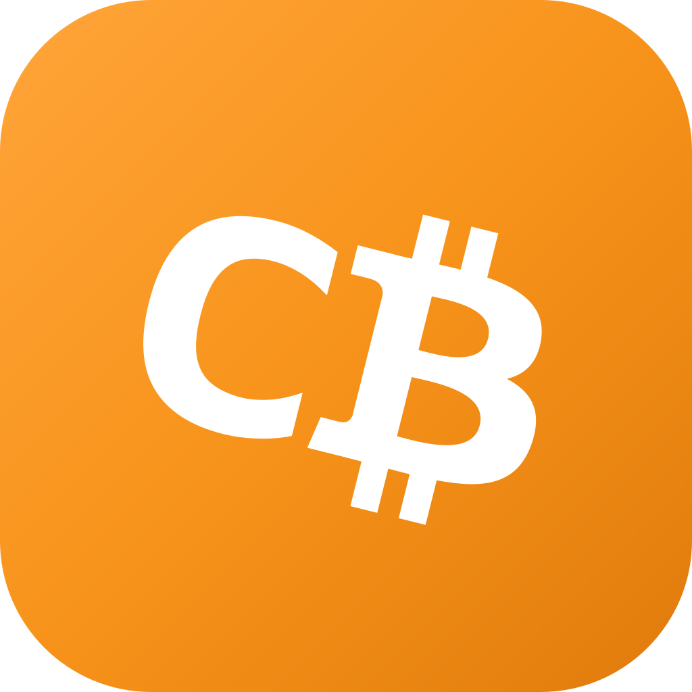
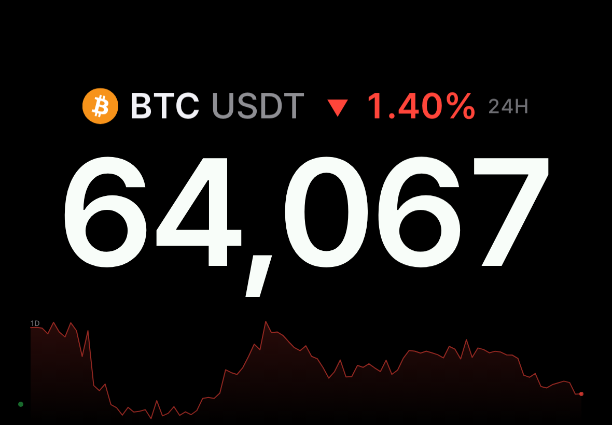
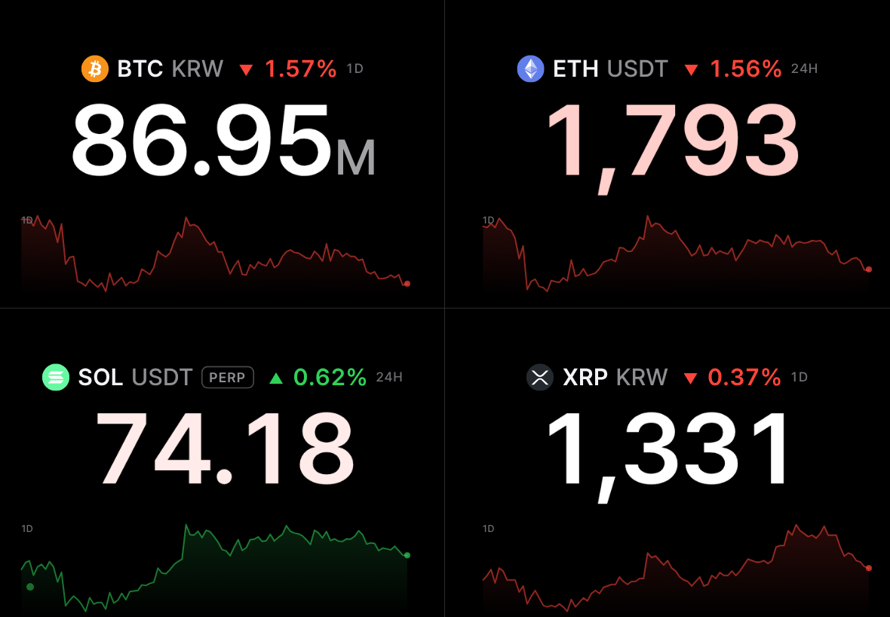
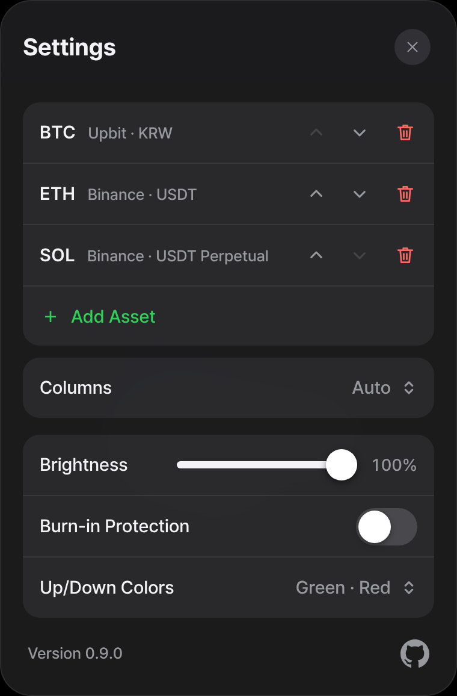

#  Coinboard user guide

English · [한국어](guide.ko.md)

Coinboard is a crypto price board: it puts live prices on a screen in large type. Open it on an iPad, an iPhone or a computer browser; it is made for a screen that stays on. There is no account and nothing to download.

- Address: https://2jiho.github.io/coinboard/
- On first opening it shows **BTC on Binance (USDT spot)**.

## Contents

1. [Getting started](#getting-started)
2. [Reading the board](#reading-the-board)
3. [Several assets (grid)](#several-assets-grid)
4. [Settings](#settings)
5. [Keeping it on](#keeping-it-on)
6. [Updates](#updates)
7. [Troubleshooting](#troubleshooting)
8. [Data and privacy](#data-and-privacy)

## Getting started

Open the address in a browser and prices appear straight away. For a board that stays up, **add it to the home screen** and open it like an app: it then opens full screen, with no address bar, and opens even without an internet connection (prices come back once it reconnects). Opened in a browser, the top of the settings panel shows how: the steps below on iPhone and iPad, an **Install** button in Chrome and Edge.

**iPad and iPhone (Safari)**

1. Open the address in Safari.
2. Tap the Share button (a square with an arrow pointing up).
3. Choose **Add to Home Screen**, then **Add**.
4. Open it from the **Coinboard** icon on the home screen.

**Android (Chrome)**

1. Open the address in Chrome.
2. From the menu (⋮) at the top right, choose **Install app** or **Add to Home screen**.

**Computer**

Open it in a browser and go full screen (F11; on macOS, Control+Command+F). Chrome and Edge can also install it as an app from the install icon at the right of the address bar.

## Reading the board

The board shows only what is needed. The settings panel follows the device's language: Korean on a device set to Korean, English otherwise.

| What you see | Meaning |
|---|---|
| Icon and `BTC` | The coin |
| `KRW` / `USDT` | The currency of the price: won on Upbit, USDT on Binance (not converted to dollars) |
| `PERP` | Binance USDT perpetual futures |
| Large number | The last traded price |
| `▲ 1.42%` / `▼ 0.64%` | The change |
| `1D` | Against the previous day's close (Upbit) |
| `24H` | Over the last 24 hours (Binance) |

**How prices are written**: always at least four figures, with no decimals that add nothing. Won from a million up is written in millions (`M`) and billions (`B`).

| Won | Example | USDT | Example |
|---|---|---|---|
| 1,000,000,000 and up | `1.235B` | 1,000 and up | `70,123` |
| 1,000,000 to 1,000,000,000 | `123.5M`, `89.96M` | 100 to 999 | `152.3` |
| 100 to 1,000,000 | `152,300` | 10 to 99 | `98.77` |
| Under 100 | `12.34` | 1 to 9 | `2.346` |
| | | Under 1 | `0.6234` |

On a device set to Korean, won is written the Korean way, in `억` (100 million) and `만` (10 thousand): `1억 2346만`, `8996만`.

**When a price changes**

- Only the digits that changed roll over, like a counter: upwards when the price rose, downwards when it fell.
- The whole price is tinted with the up or down color for a moment. The bigger the move since the last price shown, the deeper the tint: under 0.02% faint, under 0.1% normal, 0.1% or more the full color, held a little longer.
- The board changes at most once every three seconds, and with several assets every place with a new price changes at the same moment, showing the latest price received.

**The status dot**: the small dot in the bottom-left corner shows how the connection is. Tap it (or hover over it with a mouse) for details.

| Color | Meaning |
|---|---|
| Green | All well |
| Yellow | Connecting, prices delayed, ticker to check, or the screen may sleep |
| Red | Offline, or an error from the exchange |

| Detail | Meaning |
|---|---|
| `LIVE` | Receiving prices live |
| `WAITING` | Connected, waiting for the first price |
| `DELAYED` | Prices stopped for a while; reconnecting |
| `LAST PRICE` | The price shown is the last one received |
| `OFFLINE` | No internet connection |
| `ERROR` | The exchange sent an error |
| `CHECK TICKER` | No prices for that coin; it may not be listed in that market |
| `SCREEN MAY SLEEP` | Keeping the screen on was released; the screen may turn off |

While something is wrong the price is dimmed (with several assets, only in the places concerned). The browser tab shows the first asset's price too, as in `70,123 | BTCUSDT | Coinboard`.

## Several assets (grid)

With two or more assets the whole screen is divided into cells of one size, with faint lines between them, and every price is drawn at the same size. Markets can be mixed.

- **Automatic layout** (the default): of the layouts where every row has the same number of cells, the one that gives the largest type is used. In landscape, 4 are 2 × 2 and 6 are two rows of three. A count that cannot be split that way (5, 7, ...) goes in one line.
- **Columns** (cells per row) can also be set by hand (see [Settings](#settings)). Five at three per row, for example, makes rows of three and two, with the leftover place left empty.
- The first asset is top left; places fill in the order of the asset list in settings.
- Up to 20 assets; the more there are, the smaller the type.

## Settings

Tap the screen once and the settings button (a gear) appears in the bottom-right corner; it goes away again after five seconds untouched. The tap that brings the button up does not press it, so tap the button once it is showing. On a keyboard, Tab brings it up. The first time the app opens, a line at the bottom of the screen says so (*Tap the screen for settings*); it goes once the screen is touched and does not come back.

Changes apply and are saved at once (only adding an asset waits for **Add**).

The panel has two sections, **Prices** and **Display**.

**Add to Home Screen**: shown at the top only when the app is open in a browser. On iPhone and iPad it lists the steps (Share, then `Add to Home Screen`, then `Add`); in Chrome, Edge and on Android it is an **Install** button. It shows the icon the app will have there. Dismissed with ✕, it does not come back on that device; Help shows it again under *Keeping It On*. The first-visit hint also says that settings show how.

**Asset list**: a card per asset (a coin in a market), each with the coin's icon, its price now and its change.

- Drag the handle (⠿) on the right to reorder: the other cards make room, and the order is saved on release. The grid is filled top left first, in this order. On a keyboard, the up and down arrows on the handle move the card.
- The bin icon on a card deletes that asset at once. For five seconds the message at the bottom offers **Undo**, which puts it back where it was. The last asset cannot be deleted.
- An asset is not edited: to show another coin or market, add the new one and delete the old.

**Add Asset**: unfolds a market and a coin to choose. Choose, then tap **Add**, or **Cancel** to leave it. An asset already shown cannot be added again.

**Market** (in Add Asset): three buttons side by side. It starts on the market of the last asset.

- **Upbit / KRW**: Upbit, Korean won market
- **Binance / USDT**: Binance spot
- **Binance / Perpetual**: Binance USDT perpetual futures

**Coin** (in Add Asset): six common coins are listed (BTC, ETH, XRP, SOL, DOGE, ADA). For any other, choose **Other…**, type its ticker (for example `LINK`) and press Enter or **Add**. While typing, the coins really listed on that exchange are offered, and a ticker it does not list is pointed out.

**Columns**: shown with two or more assets. Tap **Auto** or 1 to 6 cells per row; 1 puts everything in one column.

**Brightness**: a slider between a small and a large sun. A filter that darkens the board (10 to 100%); It does not change the device's own brightness.

**Burn-in Protection**: for an OLED screen, which wears where it stays lit; an LCD screen does not burn in and does not need it. On by default. While it is on:

- the board floats a little (within 3% of the screen) towards a new spot every minute;
- the price is a warm off-white instead of pure white;
- the status dot is hidden while all is well (it shows when something is wrong, and with the settings button);
- a price that is not current (delayed, offline) is dimmed further;

Nothing else is dimmed: the board stays fully lit, to be read at a glance.

Switched off, the board looks as it always did.

**Keep Screen On**: whether the app is keeping the screen on right now. **On** (green dot) while it is; **Off** (yellow) when it was released, with the reason and a button to try again below; **Waiting** while the app is in the background; **Not supported** where the browser cannot do it.

**Pop Out** (desktop Chrome and Edge only): opens the board in a small window that stays on top of other windows, drawn to the window's size, with the same prices. Move and resize it as you like; press the button again (**Close Pop-out**) or close the window to end it. It closes with the tab. Other browsers do not offer such windows, so the button is not shown there.

**Up/Down Colors**: two samples drawn in their own colors: **Green · Red** (up green, down red) or the Korean convention **Red · Blue** (up red, down blue).

**At the bottom**: the app's icon, name and version, a question mark for **Help**, and a GitHub icon linking to the source code. Help is a short version of this guide inside the app (opening settings, the status dot, several assets, reading the board, keeping it on), with a link to this guide; the arrow at the top goes back to settings.

A reason and a retry button appear only when the connection or keeping the screen on has a problem. Close the panel with its close button, by tapping outside it, or with Escape; it also closes by itself after two minutes untouched.

## Keeping it on

For a board that stays up:

- **Open it from the home screen**: it runs full screen, and keeping the screen on works best this way.
- **Keep it charging**: the screen is on all the time.
- **Turn Low Power Mode off**: it can refuse to keep the screen on.
- **Auto-Lock**: the app keeps the screen on, but to be sure set Settings → Display & Brightness → Auto-Lock to **Never**.
- **Lock it to the app (optional)**: Accessibility → **Guided Access** keeps the device in Coinboard.
- **Burn-in protection**: leave it on for an OLED screen.

## Updates

New versions apply themselves. While the screen is on, the app checks every five minutes and reloads itself when there is a new version (if the settings panel is open, when it is closed). It usually takes 5 to 15 minutes after a release. To apply one at once, tap **Update Now** when it shows in settings, or close the app and open it again. The current version is at the bottom of the settings panel.

## Troubleshooting

**No price, only `—`**
It takes a few seconds after opening; up to 11 seconds on Upbit, which limits how often a browser may connect. Adding or changing a coin in a market already on the board takes a second or two. Tap the status dot to see what is happening. `OFFLINE`: check the internet connection. `ERROR` or `CHECK TICKER`: see below.

**`CHECK TICKER`**
Most likely the coin is not listed in that market: not in Upbit's won market, say, or not in Binance futures. In settings, add the coin in a market that lists it and delete this one. A coin that hardly ever trades can look like this too.

**Only the Binance futures assets show nothing**
Binance is restricted in some regions (the United States, for one). Spot prices come from Binance's market-data address and arrive there too, but futures prices and the futures coin list may not. Upbit is not affected.

**Yellow dot and `DELAYED`**
No prices for more than 15 seconds; the app is reconnecting. The last price stays on screen, dimmed, until prices come back by themselves. If it goes on, check the internet connection.

**`SCREEN MAY SLEEP`**
Keeping the screen on was released. Tap the screen once and the app asks again. Turn Low Power Mode off if it is on; failing that, set Auto-Lock as in [Keeping it on](#keeping-it-on).

**The settings button does not respond**
Tap the screen once to bring the button up, then tap the button. The first tap only shows it.

**An update has not arrived**
Wait 5 to 15 minutes, or close the app completely and open it again. The version is at the bottom of the settings panel.

**A message says settings could not be saved**
The browser is not letting the page store anything (some privacy settings, or no storage space left). Changes apply only until the page is closed. Open it in a normal window or from the home screen, and check the browser's website data settings.

## Data and privacy

- No account, no sign-in, no ads, no analytics.
- Prices are the exchanges' public market data (Upbit, Binance), received by your browser directly; no server sits in between.
- Settings stay in the browser on your device and are never sent anywhere.
- The app's files are served by GitHub Pages.
- Market data belongs to the exchanges. Coinboard is not affiliated with them and does not guarantee that prices are accurate or timely. Do not rely on it for investment decisions.
